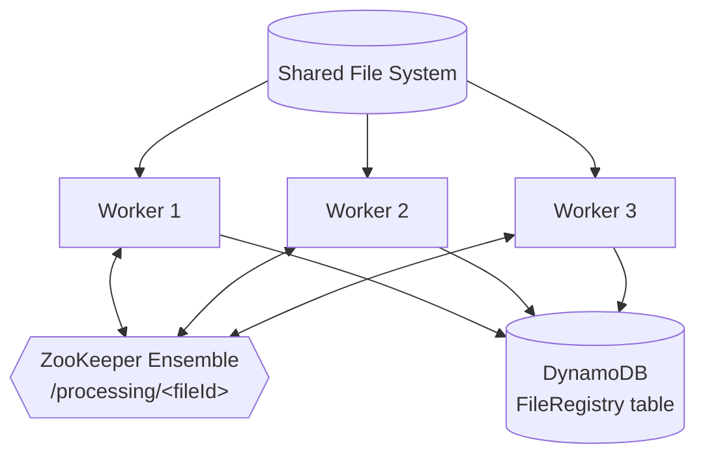

# Architecture



ASCII version:

```
           Shared File System
                  |
       +----------+----------+
       |          |          |
   Worker 1   Worker 2   Worker 3
       |          |          |
       +----------+----------+
                  |
          ZooKeeper Ensemble
                  |
       /processing/<fileId>        <- live ownership
                  |
                  v
        DynamoDB: FileRegistry      <- durable completion registry
        +--------------------+
        | fileId  (PK)       |
        | status             |
        | workerId           |
        | attempts           |
        | updatedAt          |
        | lineCount (result) |
        +--------------------+
```

## Responsibilities

| Component | Responsibility |
|-----------|----------------|
| **Shared folder** | Source of incoming files, visible to all workers |
| **Worker node** | Watches the folder, claims files, processes them |
| **ZooKeeper** | Answers *"who owns this file right now?"* — temporary, tied to worker sessions |
| **Completion registry (DynamoDB)** | Answers *"has this file already been processed?"* — durable, survives crashes. See [DynamoDB Registry](DynamoDB-Registry.md) |

## Znode layout

```
/file-monitor                          (persistent, container)
    /workers/<nodeId>                  (ephemeral)  which workers are alive
    /processing/<fileId>               (ephemeral)  data: nodeId, startTime
```

Example:

```
/processing
    /fileA -> node-1
    /fileB -> node-3
    /fileC -> node-2
```
