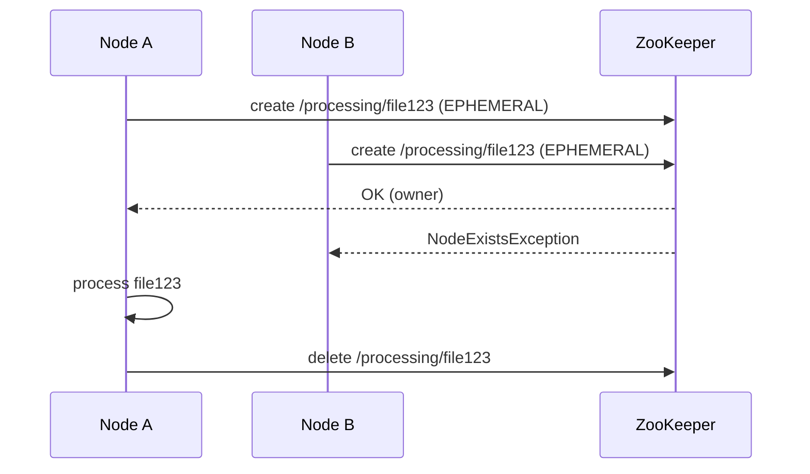

# File Ownership with Ephemeral Znodes

## The rule

> A node must successfully create the ZooKeeper ownership znode for a file before processing it.

## How the race is resolved

All three nodes discover `/data/file123.csv` and each tries to create `/processing/file123.csv` as an **ephemeral** znode:

```
Node A: create /processing/file123.csv EPHEMERAL  -> SUCCESS          (processes the file)
Node B: create /processing/file123.csv EPHEMERAL  -> NodeExistsException (skips)
Node C: create /processing/file123.csv EPHEMERAL  -> NodeExistsException (skips)
```



## Why ephemeral

If Node A crashes while holding the file:

```
Node A crashes
   ↓
ZooKeeper session expires
   ↓
/processing/file123.csv deleted automatically
   ↓
Node B can acquire ownership
   ↓
Node B retries file123.csv
```

Automatic recovery from crashed workers — no manual lock cleanup.

## Znode data

Store who owns the file, useful for debugging and monitoring:

```
nodeId=node-1
hostname=worker-23
startTime=2026-10-03T10:15:00Z
```

## Naming the znode

Filenames can contain characters that are awkward in ZooKeeper paths. Use a deterministic ID:

```java
String fileId = sha256(file.toAbsolutePath().toString());
String lockPath = "/processing/" + fileId;
```

If filenames are guaranteed unique and path-safe, `/processing/file123.csv` is fine.

## Basic code (raw ZooKeeper API)

```java
for (Path file : filesInDirectory) {
    String lockPath = "/processing/" + file.getFileName().toString();
    try {
        zooKeeper.create(
            lockPath,
            nodeId.getBytes(),
            ZooDefs.Ids.OPEN_ACL_UNSAFE,
            CreateMode.EPHEMERAL
        );

        processFile(file);              // we own it
        markCompleted(file);            // durable record
        moveToProcessedDirectory(file); // archive
        zooKeeper.delete(lockPath, -1); // release

    } catch (KeeperException.NodeExistsException e) {
        continue; // another node owns this file
    }
}
```

⚠️ This alone is **not** enough to prevent duplicates — see [Failure Scenarios](Failure-Scenarios.md) and [Completion Registry](Completion-Registry.md).
